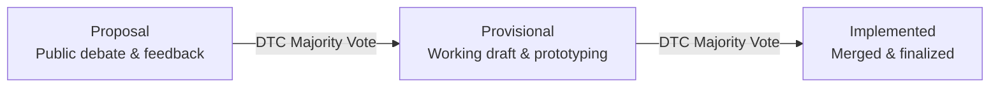
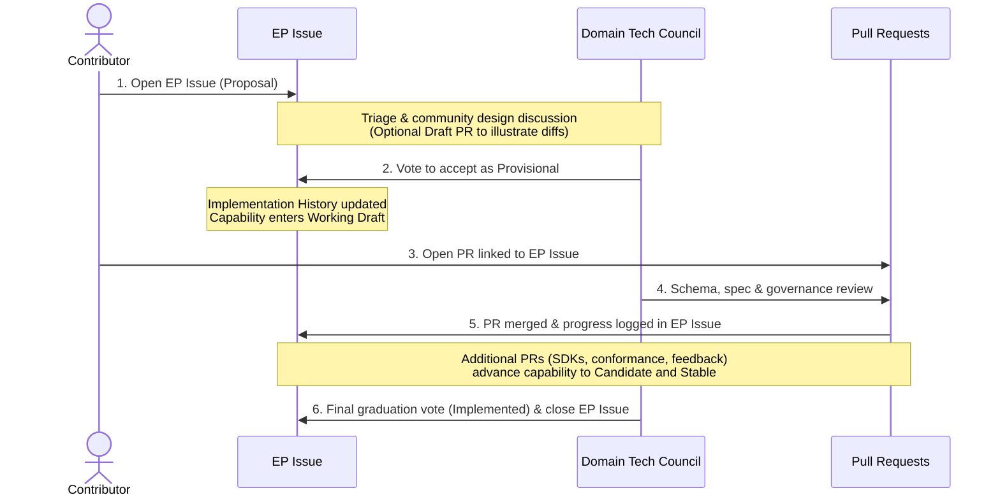
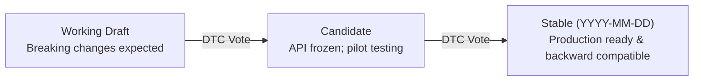

# UCP에 기여하기 { #contributing-to-ucp }

[Universal Commerce Protocol(UCP) GitHub 저장소](https://github.com/Universal-Commerce-Protocol/ucp){ target="_blank" }에서 표준을 함께 만들고 발전시킬 커뮤니티의 기여, 패치, 피드백을 환영한다. 오타 수정, 문서 개선, SDK 코드 작성, 프로토콜 확장 제안 등 어떤 형태든 여러분의 참여는 에이전트 커머스(agentic commerce)를 위한 개방형 표준을 세우는 데 도움이 된다.

---

## 첫 기여 { #your-first-contribution }

작업할 거리를 찾아보자.

* **문서 개선**: 코드 스니펫을 다듬고, 명세 문구를 명확히 하고, 문서를 개선하거나 깨진 링크를 고친다.
* **입문용 이슈**: `good first issue` 또는 `help wanted` 태그가 붙은 [열린 이슈](https://github.com/Universal-Commerce-Protocol/ucp/issues){ target="_blank" }를 살펴본다.
* **스키마 예시**: 프로토콜 기능을 보여 주는 스키마 예시 페이로드(`source/schemas/` 또는 `docs/specification/`)를 만들거나 갱신한다.
* **SDK 및 적합성 테스트 개선**: [`python-sdk`](https://github.com/Universal-Commerce-Protocol/python-sdk){ target="_blank" }, [`js-sdk`](https://github.com/Universal-Commerce-Protocol/js-sdk){ target="_blank" }, [`conformance`](https://github.com/Universal-Commerce-Protocol/conformance){ target="_blank" }의 버그를 고치거나 테스트 커버리지를 넓힌다.

### 작은 변경(바로 PR) { #small-changes-direct-pr }

일상적인 수정과 사소한 업데이트는 바로 풀 리퀘스트로 제출할 수 있다.

* 버그 수정
* 문서나 스키마 속성 설명의 명확화
* 스키마 예시 및 튜토리얼 추가

### 큰 변경(개선 제안 필요) { #major-changes-enhancement-proposal-required }

프로토콜에 대한 중요한 변경은 모두 [개선 제안 템플릿](https://github.com/Universal-Commerce-Protocol/ucp/issues/new?template=enhancement-proposal.yml){ target="_blank" }으로 정식 개선 제안(Enhancement Proposal, EP)을 제출해야 하며, Domain Tech Council(DTC)의 승인을 받아야 한다.

중요한 변경에는 다음이 포함된다.

* **코어 스키마 수정**: JSON 스키마의 필드나 설명을 추가, 삭제, 수정하는 경우.
* **프로토콜 변경**: 통신 흐름이나 기능의 기대 동작(체크아웃, 장바구니, 카탈로그, 주문, 신원 연결(Identity Linking))을 바꾸는 경우.
* **새 API 엔드포인트 / 전송 방식**: 새 전송 방식 바인딩(REST, MCP, A2A, 임베디드)이나 새 프로토콜 엔드포인트를 도입하는 경우.
* **하위 호환성 깨짐**: 기존 기능이나 스키마에 대한 모든 호환성을 깨는 변경(Governing Council 승인과 Discussions에서의 2주 전 사전 공지가 필요하다. [버전 관리](../versioning.md) 참고).

**벤더 확장 vs. 코어(`dev.ucp.*`)**: UCP는 코어 프로토콜을 가볍게 유지하도록 설계되었다. 벤더 고유의 사용 사례나 새로 떠오르는 사용 사례를 위한 새 기능이나 확장은 먼저 벤더 네임스페이스(예: `com.{vendor}.*`, [네임스페이스 거버넌스](../specification/overview/index.md#namespace-governance) 참고) 아래에서 자체 호스팅해야 하며, 여러 주체에 걸친 생태계 전반에서 널리 채택된 뒤에 `dev.ucp.*`로의 편입을 제안한다.

**기능 요청 vs 개선 제안**: 구현 계획 없이 새 기능을 제안하려면 일반 "Feature Request" 이슈를 제출한다. 기술 설계와 함께 기능을 제안한다면 "Enhancement Proposal" 이슈를 제출하고, 풀 리퀘스트에서 해당 구현을 참조한다.

---

## 개선 제안 생명주기 { #enhancement-proposal-lifecycle }

개선 제안은 프로토콜 변경을 세 단계의 생명주기에 걸쳐 추적한다.

| 단계 | 상태 및 설명 |
| --- | --- |
| **Proposal** | 커뮤니티 구성원 누구나 제출할 수 있으며, 커뮤니티와 Domain Tech Council이 공개적으로 논의한다. |
| **Provisional** | DTC 과반수 투표로 승인되며, 작업 초안 반복과 프로토타이핑 단계에 들어간다. |
| **Implemented** | DTC 과반수 투표로 확정되며, 코드, 스키마, 문서가 완성되어 병합된 상태다. |

모든 개선 제안 이슈는 다음 항목을 요구하는 표준 템플릿을 따라야 한다.

* **Summary**: 변경 사항에 대한 상위 수준의 요약.
* **Motivation**: 문제 정의와 사용자 가치.
* **Goals & Non-Goals**: 범위가 불어나지 않도록 구체적이고 측정 가능한 결과와 명시적인 범위 밖 경계.
* **Detailed Design**: 기술 명세, 스키마 영향, API 표면, 엣지 케이스.
* **Risks and Mitigations**: 호환성, 마이그레이션 고려 사항, 성능 및 보안 영향.
* **Test Plan**: 전송 방식과 적합성 테스트 스위트 전반에 걸친 검증 전략.
* **Graduation Criteria**: Candidate 및 Stable 단계로 올라가기 위한 요건.

### 개선 제안 이슈와 풀 리퀘스트의 협업 방식 { #how-enhancement-proposal-issues-and-pull-requests-work-together }

개선 제안(EP)은 서로 연결된 두 GitHub 산출물을 사용해 **설계 합의**와 **코드 및 스키마 제공**을 분리한다.

* **EP 이슈(설계 및 생명주기 추적기)**: [개선 제안 템플릿](https://github.com/Universal-Commerce-Protocol/ucp/issues/new?template=enhancement-proposal.yml){ target="_blank" }으로 연다(`enhancement-proposal` 라벨). *왜*와 *무엇*에 대한 단일 진실 공급원 역할을 하며, 동기, 상세 설계, 위험, 테스트 계획, 졸업 기준, 그리고 계속 갱신되는 `Implementation History` 로그를 담는다. EP 이슈는 기능이 **Stable**(`Implemented`)로 졸업할 때까지 기능의 생명주기 내내 열려 있다.
* **풀 리퀘스트(구체적인 구현)**: JSON 스키마(`source/`), 명세 문서(`docs/specification/`), SDK 모델, 적합성 테스트, 샘플 등 *어떻게*를 제공한다. EP를 구현하는 모든 PR은 PR 설명의 `## Related Issues` 아래에 추적 이슈를 다시 연결해야 한다(점진적 PR에는 `Part of #<issue-number>`를, 최종 졸업을 완료할 때는 `Fixes #<issue-number>`를 사용한다).

#### 단계별 워크플로 { #step-by-step-workflow }

1. **EP 이슈를 먼저 연다(`Proposal` 단계)**:
   전체 구현 코드를 작성하거나 병합 가능한 PR을 열기 전에 EP 이슈를 제출한다. *(선택 사항: 구체적인 JSON 스키마 diff나 프로토타입 코드가 설계를 설명하는 데 도움이 된다면 EP 이슈에 연결된 **Draft PR**을 열 수 있다. 다만 EP가 `Provisional` 상태에 이르기 전에는 구현 PR이 병합되지 않는다.)*
2. **설계 리뷰 및 Provisional 승인(`Proposal` → `Provisional`)**:
   트리아저가 EP 이슈에 기능 도메인별 라벨(예: `area:shopping`, `area:payments`, `area:lodging`, `area:food`, `area:common`)을 붙이고 관련 **Domain Working Group**(DWG)과 **Domain Tech Council**(DTC)에 전달한다. 열린 설계 쟁점이 해결되면 DTC는 제안을 **Provisional**로 받아들일지 투표하고, 그 결정을 이슈의 `Implementation History` 섹션에 기록한다.
3. **구현 PR 제출(`Provisional` 단계)**:
   EP 이슈가 **Provisional**로 승인되면(기능 성숙도 `Working Draft` 단계 진입) `Part of #<EP-issue-number>`를 참조하는 구현 PR을 연다(또는 *Ready for Review*로 표시한다). 규모가 큰 제안은 여러 저장소에 걸친 여러 PR로 나뉘는 경우가 많다(예: `ucp`에 코어 스키마와 명세를 반영한 뒤, `ucp-schema`에 검증 규칙, `python-sdk`/`js-sdk`에 SDK 지원, `conformance`에 테스트를 추가한다).
4. **졸업을 향한 반복(`Provisional` → `Implemented`)**:
   구현 PR이 병합되고 실제 도입 피드백이 반영되면서 기능이 `Working Draft`에서 `Candidate`, `Stable`로 올라가면, 메인테이너가 EP 이슈의 `Implementation History`를 갱신한다. 졸업 기준과 적합성 테스트를 충족하면 DTC가 최종 투표를 거쳐 EP를 **Implemented**로 표시하고(기능을 **Stable**로 승격), EP 이슈를 닫는다.

---

## 기능 성숙도 단계 { #capability-maturity-levels }

개선 제안이 Provisional 상태에 이르면, 새 기능은 세 가지 성숙도 단계를 거친다.

| 단계 | 버전 태그 | 안정성 보장 | 목적 | 종료 기준 |
| --- | --- | --- | --- | --- |
| **Working Draft** | `Working Draft` | 호환성을 깨는 변경이 예상됨 | 프로토타이핑, 피드백 수집, 설계 반복 | 다음 단계로 진행하기 위한 DTC 과반수 투표 |
| **Candidate** | `Candidate` | API 표면은 안정, 구현 세부 사항은 변경될 수 있음 | 얼리 어답터 구현, 프로덕션 파일럿 | 다음 단계로 진행하기 위한 DTC 과반수 투표 |
| **Stable** | `YYYY-MM-DD` | 완전한 하위 호환성([버전 관리](../versioning.md) 참고) | 프로덕션 배포 | 날짜 기반 버전 부여 |

---

## 저장소 구조 { #repository-structure }

Universal Commerce Protocol 생태계는 [Universal-Commerce-Protocol](https://github.com/Universal-Commerce-Protocol){ target="_blank" } GitHub 조직 아래의 전용 Git 저장소들로 구성된다.

* **🏠 [`/ucp`](https://github.com/Universal-Commerce-Protocol/ucp){ target="_blank" }**: 코어 명세 저장소. 프로토콜 정의, 웹사이트(ucp.dev), 명세 사이트 생성기를 담고 있다.
* **📜 [`/ucp-schema`](https://github.com/Universal-Commerce-Protocol/ucp-schema){ target="_blank" }**: JSON 스키마와 Rust 기반 검증·생성 도구.
* **🧪 [`/conformance`](https://github.com/Universal-Commerce-Protocol/conformance){ target="_blank" }**: pytest로 작성된 프로토콜 적합성 테스트 스위트.
* **⚙️ [`/python-sdk`](https://github.com/Universal-Commerce-Protocol/python-sdk){ target="_blank" } & [`/js-sdk`](https://github.com/Universal-Commerce-Protocol/js-sdk){ target="_blank" }**: 프로토콜 스키마로부터 생성된 공식 언어별 SDK.
* **🔎 [`/samples`](https://github.com/Universal-Commerce-Protocol/samples){ target="_blank" }**: 레퍼런스 판매자 구현(FastAPI, Node.js).
* **♥️ [`/.github`](https://github.com/Universal-Commerce-Protocol/.github){ target="_blank" }**: 조직 전체에 적용되는 상태(health) 파일, 이슈 템플릿(`enhancement-proposal.yml`, `bug-report.yml`), 커뮤니티 거버넌스 기본값.

---

## 첫 PR을 열기 전 체크리스트 { #checklist-before-opening-your-first-pr }

* [ ] **CLA**: [Google 기여자 라이선스 계약(CLA)](https://cla.developers.google.com/){ target="_blank" }에 서명했는가?
* [ ] **사전 확인**: 이 버그/기능을 추적하는 기존 이슈가 있고, 그 이슈가 본인에게 할당되어 있는가?
* [ ] **브랜치**: `main`에서 브랜치를 따고, 커밋을 원자적으로 유지하고 있는가?
* [ ] **검증**: 로컬 린터(`pre-commit`), 스키마 검증기(`ucp-schema lint source/`), 적합성 테스트 스위트를 실행했는가?
* [ ] **PR 제목 및 설명**: PR 제목이 **Conventional Commits**(예: `feat: ...`, `fix: ...`, `docs: ...`, 호환성을 깨는 변경에는 `feat!: ...`)를 따르는가? 설명에 **왜**와 **무엇**이 바뀌었는지 적고 관련 이슈 링크를 넣었는가?

---

## 시작하기 { #getting-started }

바로 시작할 준비가 되었다면 [UCP GitHub 조직](https://github.com/Universal-Commerce-Protocol){ target="_blank" }에서 저장소를 둘러보고, [열린 이슈](https://github.com/Universal-Commerce-Protocol/ucp/issues){ target="_blank" }를 살펴보거나, 첫 풀 리퀘스트를 제출해 보자.

프로토콜이 처음이라면 [핵심 개념](core-concepts.md)에서 아키텍처를 익히고, 레퍼런스 구현은 [샘플](https://github.com/Universal-Commerce-Protocol/samples){ target="_blank" }에서 살펴보고, [GitHub Discussions](https://github.com/Universal-Commerce-Protocol/ucp/discussions){ target="_blank" }에서 대화에 참여하자.
