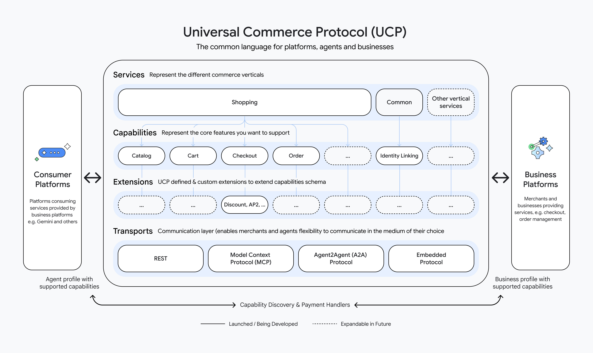

<!--
   Copyright 2026 UCP Authors

   Licensed under the Apache License, Version 2.0 (the "License");
   you may not use this file except in compliance with the License.
   You may obtain a copy of the License at

       http://www.apache.org/licenses/LICENSE-2.0

   Unless required by applicable law or agreed to in writing, software
   distributed under the License is distributed on an "AS IS" BASIS,
   WITHOUT WARRANTIES OR CONDITIONS OF ANY KIND, either express or implied.
   See the License for the specific language governing permissions and
   limitations under the License.
-->

# 핵심 개념 { #core-concepts }

Universal Commerce Protocol(UCP)은 커머스 주체 간 상호운용성을 위한 개방형
표준이다. 공통 언어와 기능 단위의 기본 요소(primitive)를 정의해, 플랫폼과
비즈니스가 여러 상거래 분야에 걸쳐 안전하고 안정적으로 상호운용할 수 있게 한다.

이 문서는 UCP의 상세 기술 명세를 제공한다. 모든 데이터 모델과 스키마의 전체 정의는
[스키마 레퍼런스](../specification/reference.md)를 참고한다.

!!! note "용어"
    이 문서 전반에서 **플랫폼**은 기능(Capability)을 *사용하는* 모든 주체를 가리킨다.
    앱, AI 에이전트, 구매 조달 시스템, 또는 다른 비즈니스일 수 있다. **비즈니스**는
    기능을 *노출하는* 모든 주체를 가리킨다. 소매업체, 공급업체, 서비스 제공자 등
    커머스 기능을 제공하는 모든 참여자가 해당한다. 이 역할은 산업 분야가 아니라
    기능이 흐르는 방향으로 정의되므로, UCP는 B2C, B2B, 에이전트 간 커머스에 똑같이
    적용된다.

UCP의 주된 목표는 다음을 가능하게 하는 것이다.

* **플랫폼:** 비즈니스가 노출하는 기능을 동적으로 발견하고 사용한다.
* **비즈니스:** 무엇을 제공하고 어떻게 운영하는지 한 번만 선언하면, 호환되는 모든
    플랫폼이 맞춤 연동 없이 이를 발견하고 사용할 수 있다.
* **결제 및 자격 증명 제공자:** 토큰화, 보관(vaulting), 자격 증명 발급 같은
    서비스를 한 번만 노출하면, 호환되는 모든 플랫폼과 비즈니스에서 사용자의 안전한
    커머스를 뒷받침할 수 있다.

## 상위 수준 아키텍처 { #high-level-architecture }

<!-- Responsive image: shows ucp-diagram-mobile.jpg on small screens (<=600px)
     and ucp-diagram.jpg on larger screens. -->
<picture>
  <source media="(max-width: 600px)" srcset="../assets/ucp-diagram-mobile.jpg">
  
</picture>

## UCP의 핵심 목표 { #key-goals-of-ucp }

* **상호운용성:** 플랫폼, 비즈니스, 결제 생태계 사이의 간극을 메운다.
* **디스커버리:** 플랫폼이 비즈니스가 지원하는 기능을 동적으로 발견할 수 있게
    한다(예: "체크아웃을 지원하는가?", "풀필먼트 옵션이나 신원 연결을 지원하는가?").
* **보안:** 민감한 사용자 데이터와 결제 데이터를 표준 기반(OAuth 2.0, PCI-DSS 준수
    패턴)으로 안전하게 교환하도록 돕는다.
* **에이전트 커머스:** AI 에이전트가 다양한 주체(개인, 조직, 또는 다른 에이전트)를
    대신해 행동하고, 여러 운용 방식(사람 개입형(human-in-the-loop), 완전 자율형)을
    지원할 수 있게 한다.

## 역할과 참여자 { #roles-participants }

UCP는 서로 다른 네 행위자 간의 상호작용을 정의하며, 각 행위자는 상호작용
생명주기에서 특정한 역할을 맡는다.

### 플랫폼(애플리케이션/에이전트) { #platform-applicationagent }

플랫폼은 비즈니스가 노출한 기능을 사용하는 모든 주체다. AI 에이전트, 모바일 앱,
구매 조달 시스템, 또는 기능 사용자로 행동하는 다른 비즈니스일 수 있다. 플랫폼은
비즈니스가 무엇을 지원하는지 발견하고, 자신의 주체(사용자, 자동화된 프로세스, 또는
다른 시스템)를 대신해 적절한 기능을 호출하면서 상호작용을 조율한다.

* **책임:** 프로필을 통해 비즈니스 기능을 발견하고, 기능 세션을 시작·관리하며,
    협상된 기능의 범위 안에서 자신의 주체를 대신해 행동한다.
* **예시:** AI 쇼핑 어시스턴트, 슈퍼 앱, 검색 엔진, B2B 구매 조달 시스템.

### 비즈니스 { #business }

기능을 노출하는 주체다. 거래 맥락에서 비즈니스는 보통 **판매 책임 주체(Merchant of
Record, MoR)** 역할을 하며, 거래에 대한 재무적 책임과 소유권을 가진다. 다만 UCP의
기능 모델이 거래 사용 사례로 한정되는 것은 아니다.

* **책임:** UCP 프로필을 게시하고, 지원하는 서비스·기능·확장을 선언하며, 상태를
    가질 수도 있고 가지지 않을 수도 있는 기능 호출을 처리한다.
* **예시:** 소매업체, 항공사, 호텔 체인, 서비스 제공자, 공급업체, 유통업체.

### 자격 증명 제공자(CP) { #credential-provider-cp }

민감한 사용자 데이터, 특히 결제 수단과 배송 주소를 안전하게 관리하고 공유하는 신뢰할
수 있는 주체다.

* **책임:** 사용자를 인증하고, 결제 토큰을 발급하며(원본 카드 데이터가 플랫폼에
    닿지 않도록), 다른 당사자의 컴플라이언스 범위를 최소화하도록 PII를 안전하게
    보관한다.
* **예시:** 디지털 지갑(예: Google Wallet, Apple Pay), 신원 제공자(Identity
    Provider).

### 결제 서비스 제공자(PSP) { #payment-service-provider-psp }

비즈니스를 대신해 결제를 처리하는 금융 인프라 제공자다.

* **책임:** 거래를 승인(authorize)하고 매입(capture)하며, 정산을 처리하고, 카드
    네트워크와 통신한다. PSP는 자격 증명 제공자가 제공한 토큰을 직접 다루는 경우가
    많다.
* **예시:** Stripe, Adyen, PayPal, Braintree, Chase Paymentech.

## 핵심 개념 요약 { #core-concepts-summary }

UCP는 주체 간 상호작용 방식을 정의하는 세 가지 기본 구성 요소를 중심으로 동작한다.

### 기능 { #capabilities }

기능(Capability)은 비즈니스가 지원한다고 선언하는, 개별적이고 버전이 매겨진 기능
단위다. 프로토콜의 "동사"에 해당하며, 플랫폼이 발견하고 협상하고 호출할 수 있는
기능 단위다.

각 기능은 역도메인 이름(예: `dev.ucp.shopping.checkout`)으로 식별되며 날짜 기반
버전을 가진다. 기능은 `/.well-known/ucp`에 있는 비즈니스의 UCP 프로필에 선언되고,
정확한 버전 일치로 협상되며, 모든 응답에서 확인된다. 따라서 플랫폼은 특정
상호작용에서 활성화된 기능 집합을 항상 알 수 있다. UCP가 작성한 `dev.ucp.*` 기능과
확장은 명세와 보조를 맞춰 버전이 매겨진다. 각각은 자신이 포함된 UCP 릴리스의 날짜
`D`를 선언한다. 서드파티 확장은 자체 주기에 따라 버전을 게시한다.

다음은 UCP에 정의된 기능의 예시다. 공식적이고 최신인 목록은
[명세](../specification/overview/index.md)를 참고한다.

| 기능 | 설명 |
| :--- | :--- |
| `dev.ucp.shopping.checkout` | 구매 세션을 시작하고 완료한다 |
| `dev.ucp.shopping.cart` | 체크아웃 전 장바구니 관리 |
| `dev.ucp.shopping.catalog.search` | 비즈니스 카탈로그 전체 검색 |
| `dev.ucp.shopping.catalog.lookup` | ID로 특정 상품 조회 |
| `dev.ucp.shopping.order` | 주문 생명주기 이벤트 |
| `dev.ucp.shopping.permalink` | 미리 채워진 장바구니와 상품으로 연결되는 공유 가능한 링크 |
| `dev.ucp.common.identity_linking` | OAuth 기반 계정 연결 |
| `dev.ucp.common.location.search` | 오프라인 매장과 픽업 위치 검색 |
| `dev.ucp.common.location.lookup` | 위치 상세 정보, 영업시간, 편의 시설 조회 |
| `dev.ucp.common.ask` | 비즈니스의 리소스, 정책, 서비스에 대한 자연어 질문 |
| `dev.ucp.lodging.booking` | 호텔 예약 세션을 시작하고 완료한다 |

### 확장 { #extensions }

확장은 기본 기능을 선택적으로 보강한다. 확장은 `extends` 필드로 상위 기능을
선언하고, JSON Schema `allOf`를 사용해 기본 스키마 위에 합성된다. 확장은 코어 기능과
함께 `ucp.capabilities{}`에 나타난다.

<!-- ucp:example schema=profile def=business_schema target=$.ucp.capabilities -->
```json
{
  "dev.ucp.shopping.fulfillment": [
    {
      "version": "{{ ucp_version }}",
      "extends": "dev.ucp.shopping.checkout",
      "spec": "https://ucp.dev/{{ ucp_version }}/specification/shopping/extensions/fulfillment",
      "schema": "https://ucp.dev/{{ ucp_version }}/schemas/shopping/fulfillment.json"
    }
  ]
}
```

`extends`를 선언했지만 상위 기능이 협상된 교집합에 없는 확장은 자동으로 제거된다.
이를 통해 확장의 일관성이 보장된다. 할인 확장이 확장 대상인 체크아웃 없이 활성화되는
일은 없다.

다음은 UCP에 정의된 확장의 예시다. 공식적이고 최신인 목록은
[명세](../specification/overview/index.md)를 참고한다.

| 확장 | 확장 대상 | 설명 |
| :--- | :--- | :--- |
| `dev.ucp.shopping.discount` | checkout, cart | 할인 코드와 프로모션 |
| `dev.ucp.shopping.fulfillment` | checkout | 배송 및 배달 옵션 |
| `dev.ucp.shopping.buyer_consent` | checkout, cart | 명시적 동의 수집 |
| `dev.ucp.common.loyalty` | checkout, cart, catalog | 회원 혜택, 리워드, 포인트 적립 |
| `dev.ucp.common.payment.authentication` | checkout | 브라우저 화면 기반 기기 데이터 수집과 3DS 챌린지 |
| `dev.ucp.common.payment.ap2_mandate` | checkout | 자율 커머스를 위한 부인 방지 승인 |
| `dev.ucp.common.payment.split_payments` | checkout | 여러 결제 수단 배분과 분할 정산 |
| `dev.ucp.common.payment.terms` | checkout | 보증금, 할부, 후불 결제 일정 |

### 서비스 { #services }

**서비스**는 특정 분야나 공통 도메인의 작업과 이벤트를 역도메인 레지스트리 키(예:
`dev.ucp.shopping`, `dev.ucp.common`) 아래에 묶는다. 이 키가 서비스를 식별한다.
서비스는 해당 분야나 도메인에 *어떤* 기능이 있는지 선언하고, 서비스 배열의 각 항목은
전송 방식 바인딩을 통해 *어떻게* 접근하는지 선언한다.

하나의 서비스는 여러 전송 방식 바인딩으로 접근할 수 있다.

| 전송 방식 | 형식 | 적합한 용도 |
| :--- | :--- | :--- |
| **REST** | OpenAPI 3.1.0 | 표준 서버 간 연동 |
| **MCP** | OpenRPC | Model Context Protocol을 통한 AI 에이전트 |
| **A2A** | Agent Card | Agent-to-Agent 프로토콜 연동 |
| **임베디드** | OpenRPC | 임베디드 연동 |

비즈니스는 각 서비스 안에서 지원하는 전송 방식 바인딩을 선언하고, 플랫폼은 자신의
맥락에 맞는 것을 고른다. AI 에이전트는 MCP를 선호할 수 있고, 전통적인 웹 앱은 REST를
쓸 수 있다. UCP가 정의한 모든 서비스는 선택된 `ucp.version`과 같은 `version`을
명시적으로 선언하며, 항목들은 전송 방식 바인딩만 다르므로 모든 항목에 이 값을 반복한다.
전송 방식 바인딩에는 별도의 버전이 없다.

서비스 네임스페이스는 새로운 분야를 위한 UCP의 확장 메커니즘이기도 하다. 비즈니스는
지원하는 서비스를 선언하는 방식으로 참여한다.

## 디스커버리와 기능 협상 { #discovery-capability-negotiation }

UCP는 프로필 기반 디스커버리 모델을 사용한다. 모든 비즈니스는 지원하는 서비스, 기능,
결제 핸들러를 선언하는 기계 판독 가능한 프로필을 `/.well-known/ucp`에 게시한다.
플랫폼은 매 요청마다 `UCP-Agent` 헤더로 자신의 프로필 URL을 알린다.

```text
POST /checkout-sessions HTTP/1.1
UCP-Agent: profile="https://agent.example/profiles/shopping-agent.json"
```

이 설계는 **허가 없는 온보딩**(permissionless onboarding)을 가능하게 한다. 발견
가능한 프로필이 있는 플랫폼이라면 사전 등록 없이 어떤 비즈니스와도 상호작용할 수 있다.
비즈니스는 여기에 더해 대역 외(out-of-band) 온보딩 및 검증 메커니즘(API 키, OAuth
자격 증명, mTLS 인증서)을 통해 알려진 플랫폼과 신뢰를 구축할 수도 있다.

### 기능 교집합 { #capability-intersection }

기능 협상은 **서버 선택(server-selects)** 아키텍처를 따른다. 비즈니스는 자신이 선언한
기능과 플랫폼 프로필에 있는 기능의 교집합을 계산해 활성 기능을 결정한다.

1. **이름으로 교집합** — 양쪽 모두가 선언한 기능만 후보가 된다.
2. **버전 선택** — 일치한 각 기능에 대해 비즈니스와 플랫폼 배열 양쪽에 있는 버전
   집합을 계산한다. 그중 가장 높은 버전(가장 최근 날짜)을 선택한다. 공통 버전이
   없으면 그 기능은 제외한다.
3. **고아 확장 제거** — 상위 기능이 교집합에 **하나도** 없는 확장은 제거된다.
   제거는 더 이상 변화가 없을 때까지 반복한다(연쇄 관계 처리).

결과는 최소한의, 서로 호환되는 기능 집합이다. 비즈니스는 모든 응답에 활성 기능을
포함하므로, 플랫폼은 특정 상호작용에 어떤 기능이 적용되는지 항상 알 수 있다.

### 프로필 구조 { #profile-structure }

비즈니스 프로필과 플랫폼 프로필은 공통 기본 구조를 공유한다. 프로토콜 버전, 서비스,
기능, 결제 핸들러를 선언하는 `ucp` 객체와, JWK 공개 키 배열인 `keys`(유효한
[RFC 7517](https://datatracker.ietf.org/doc/html/rfc7517) JWK Set이며 Web Bot
Auth 키 소스로 재사용 가능)로 이루어진다. `ucp` 객체는 둘 사이에 차이가 있다.
비즈니스 프로필은 비즈니스 전용 스키마를 사용하고(`/.well-known/ucp`에 호스팅),
플랫폼 프로필은 플랫폼 전용 스키마를 사용한다(플랫폼이 요청마다 알리는 URI에 호스팅).
기능 *과* 키를 한 문서에 담는 이 이중 목적 프로필 덕분에 디스커버리와 인증이 함께
해결된다.

<!-- ucp:example schema=profile def=business_schema -->
```json
{
  "ucp": {
    "version": "{{ ucp_version }}",
    "services": {
      "dev.ucp.shopping": [
        {
          "version": "{{ ucp_version }}",
          "spec": "https://ucp.dev/{{ ucp_version }}/specification/overview/",
          "transport": "rest",
          "schema": "https://ucp.dev/{{ ucp_version }}/services/shopping/rest.openapi.json",
          "endpoint": "https://business.example.com/ucp/v1"
        }
      ]
    },
    "capabilities": {
      "dev.ucp.shopping.checkout": [{
        "version": "{{ ucp_version }}",
        "spec": "https://ucp.dev/{{ ucp_version }}/specification/shopping/checkout",
        "schema": "https://ucp.dev/{{ ucp_version }}/schemas/shopping/checkout.json"
      }],
      "dev.ucp.shopping.fulfillment": [{
        "version": "{{ ucp_version }}",
        "spec": "https://ucp.dev/{{ ucp_version }}/specification/shopping/extensions/fulfillment",
        "schema": "https://ucp.dev/{{ ucp_version }}/schemas/shopping/fulfillment.json",
        "extends": "dev.ucp.shopping.checkout"
      }]
    },
    "payment_handlers": {
      "com.example.processor_tokenizer": [{
        "id": "processor_tokenizer",
        "version": "{{ ucp_version }}",
        "spec": "https://example.com/specs/payments/processor_tokenizer",
        "schema": "https://example.com/specs/payments/merchant_tokenizer.json"
      }]
    }
  },
  "keys": [{ "kid": "key_2026", "kty": "EC", "crv": "P-256", "x": "WbbXwVYGdJoP4Xm3qCkGvBRcRvKtEfXDbWvPzpPS8LA", "y": "sP4jHHxYqC89HBo8TjrtVOAGHfJDflYxw7MFMxuFMPY", "alg": "ES256" }]
}
```

## 네임스페이스 거버넌스 { #namespace-governance }

UCP는 역도메인 명명 방식을 사용해 거버넌스 권한을 역도메인 식별자에 직접 담는다.
덕분에 중앙 레지스트리가 필요 없으며, 도메인 소유자가 자신의 네임스페이스를 직접
관리한다.

```text
{reverse-domain}.{service}.{capability}
```

| 이름 | 권한 기관 | 관리 주체 |
| :--- | :--- | :--- |
| `dev.ucp.shopping.checkout` | ucp.dev | UCP 관리 기구 |
| `dev.shopify.catalog` | shopify.dev | Shopify |
| `com.example.payments.installments` | example.com | example.com |

역도메인 이름은 충돌 없는 **식별자**(키와 참조)로 쓰이는 동시에, `schema` URL을
선언하는 **엔티티**(기능, 서비스, 결제 핸들러)에서도 쓰인다. 엔티티의 `schema` URL은
반드시 해당 네임스페이스의 권한 도메인에서 나와야 한다. 이는 역도메인 이름을 도메인
소유자가 통제한다는 **출처**(provenance)를 보장할 뿐, 엔티티가 신뢰할 만하다는 것을
보장하지는 않는다. 엔티티를 신뢰하거나 지원할지는 여전히 클라이언트가 결정한다.

플랫폼은 선언된 `schema` URL에 대해 이 바인딩을 반드시 검증해야 하며(**MUST**),
검증에 실패한 엔티티는 반드시 거부해야 한다(**MUST**). 식별자에는 가져올 URL이
없으며, `spec`(문서) URL은 권한에 묶이지 않는다(어떤 `https` 출처든 가능). 규범적
알고리즘은 [권한 바인딩](../specification/overview/index.md#authority-binding)을
참고한다.

`dev.ucp.*` 네임스페이스는 해당 기능 도메인을 담당하는 UCP Tech Council이 관리하는
기능에만 독점적으로 예약되어 있다. 모든 벤더는 UCP 메인테이너의 승인 없이 자신의
도메인(`org.acme.*`) 아래에 기능을 정의하고 게시할 수 있다. 벤더 기능도 같은 확장
모델을 따르므로, UCP 기본 기능을 확장하거나(예: `dev.ucp.shopping.checkout`을
확장하는 `org.acme.loyalty`) 완전히 새로운 기능을 정의할 수 있다. 협상은 항상
옵트인 방식이므로 벤더 기능은 양쪽이 모두 선언할 때만 활성화되며, 이로써 프로토콜은
설계 단계부터 탈중앙화된 상태를 유지한다.

## 결제 아키텍처 { #payment-architecture }

UCP는 결제 수단 수락과 결제 처리를 분리해, 플랫폼·비즈니스·결제 처리업체 사이의
N 대 N 복잡도 문제를 해결한다.

### 신뢰 삼각형 { #the-trust-triangle }

이 절에서 "결제 자격 증명 제공자"는 앞서 정의한 CP 및/또는 PSP 역할을 가리킨다.
결제 핸들러에 따라 둘은 같은 주체일 수도, 서로 다른 주체일 수도 있다.

결제 모델은 세 가지 양자 간 신뢰 관계 위에 세워진다.

1. **비즈니스 ↔ 결제 자격 증명 제공자** — 이미 존재하는 법적·기술적 관계다.
   비즈니스는 결제 자격 증명 제공자의 API 키와 계약을 보유한다.
2. **플랫폼 ↔ 결제 자격 증명 제공자** — 플랫폼은 결제 자격 증명 제공자의
   인터페이스(예: iframe 또는 API)와 상호작용해 데이터를 토큰화하지만, 자금의
   "소유자"는 아니다.
3. **플랫폼 ↔ 비즈니스** — 플랫폼은 결과(토큰 또는 위임(Mandate))를 비즈니스에
   전달해 주문을 확정한다.

자격 증명은 **플랫폼 → 비즈니스** 방향으로만 흐른다. 비즈니스는 응답에 자격 증명을
되돌려 보내서는 안 된다(**MUST NOT**).

### 결제 핸들러 { #payment-handlers }

결제 핸들러는 엔티티가 아니라 **명세**다. 특정 결제 수단을 어떻게 획득하고 처리하는지
정의한다. 차이는 다음과 같다.

* **자격 증명 제공자(CP) / PSP** — 토큰을 발급하고 결제를 처리하는 참여자다.
  핸들러에 따라 같은 주체일 수도, 별개의 주체일 수도 있다(예: Google Pay가 토큰화하고
  비즈니스의 PSP가 처리).
* **결제 핸들러** — 프로토콜을 정의하는 명세(예: `com.google.pay`,
  `dev.shopify.shop_pay`)

결제 생명주기의 3단계는 다음과 같다.

1. **협상** — 비즈니스는 체크아웃의 내용과 협상된 속성에 따라 사용 가능한 결제
   핸들러를 프로필과 체크아웃 응답에 알린다.
2. **획득** — 플랫폼은 핸들러의 로직을 실행해 CP로부터 결제 수단(토큰 또는 암호화된
   페이로드)을 직접 획득한다.
3. **완료** — 플랫폼은 결제 수단을 비즈니스에 제출하고, 비즈니스는 자신의 PSP 연동을
   통해 대금을 청구한다.

## 보안과 인증 { #security-authentication }

### 신원과 키 디스커버리 { #identity-key-discovery }

UCP 프로필은 기능 선언 **과** 서명 키 게시라는 두 가지 목적을 함께 수행한다. 양쪽
모두 기능 협상에 쓰는 바로 그 프로필 문서에서 키를 찾으므로, 별도의 키 관리 단계가
필요 없다.

키 조회 절차는 다음과 같다.

1. 서명자의 프로필 URL을 얻는다(`UCP-Agent` 헤더 또는 `/.well-known/ucp`에서).
2. 프로필을 가져와 캐시한다.
3. `Signature-Input`의 `keyid`를 `keys[]`의 `kid`와 대조한다.
4. 대응하는 공개 키로 서명을 검증한다.

### 인증 메커니즘 { #authentication-mechanisms }

UCP는 여러 인증 모델을 지원한다.

| 메커니즘 | 온보딩 | 비고 |
| :--- | :--- | :--- |
| **HTTP 메시지 서명** ([RFC 9421](https://www.rfc-editor.org/rfc/rfc9421)) | 허가 불필요 | 키를 프로필에서 발견하므로 사전 교환이 필요 없음 |
| **OAuth 2.0** | 사전 구성 | 클라이언트 자격 증명 또는 인가 코드 |
| **API 키** | 사전 구성 | 대역 외로 교환한 사전 공유 비밀 |
| **mTLS** | 사전 구성 | 클라이언트 인증서를 사용하는 상호 TLS |

HTTP 메시지 서명은 허가 없는 상호작용을 가능하게 하는 유일한 메커니즘이다. 공개 키는
각 당사자의 프로필에서 발견되므로 사전에 자격 증명을 교환할 필요가 없다.

비즈니스가 웹훅으로 업데이트를 보낼 때도 같은 방식으로 신원을 증명한다. 요청에는
비즈니스의 프로필을 가리키는 `UCP-Agent` 헤더가 실려 있고, 플랫폼은 그 프로필에
게시된 서명 키로 서명을 검증한다.

### 신원 연결 { #identity-linking }

`dev.ucp.common.identity_linking` 기능을 사용하면 플랫폼이 비즈니스에서 사용자를
대신해 행동할 수 있는 OAuth 2.0 인가를 얻을 수 있다. 이를 통해 로열티 혜택, 맞춤형
혜택, 위시리스트, 인증된 체크아웃을 이용할 수 있게 된다. 비즈니스는 자신의 OAuth 2.0
서버 메타데이터를 `/.well-known/oauth-authorization-server`에 게시한다.

## 버전 관리 { #versioning }

UCP는 날짜 기반 버전 식별자(`YYYY-MM-DD`)를 사용한다. UCP 릴리스 `D`는 코어
프로토콜(서비스와 전송 방식 바인딩, 기능, 확장, 공유 스키마)의 스냅숏으로, 내부적으로
서로 호환되는 하나의 묶음으로 함께 게시된다. 프로필의 `ucp.version`이 그 스냅숏을
선택하며, 일치는 정확해야 한다. 이전 날짜는 비즈니스가 `supported_versions`에 알린
경우에만 사용할 수 있다. 게시된 스냅숏에는 승인된 하위 호환 추가 사항이 시간이 지나며
더해질 수 있으며, 이전에 가져온 사본도 계속 유효하다.

릴리스 `D`에 포함된 UCP 정의 서비스, 기능, 확장은 모두 버전 `D`를 선언한다. 서드파티
확장과 결제 핸들러는 UCP 릴리스와 무관하게 작성자가 버전을 매긴다.

버전 디스커버리는 [프로토콜 버전](../specification/overview/index.md#protocol-version)을,
규범적 릴리스 계약은 [컴포넌트 버전 관리와 릴리스 스냅숏](../specification/overview/index.md#component-versioning-and-release-snapshots)을,
릴리스 브랜치와 백포트 절차는 [버전 관리](../versioning.md)를 참고한다.
