---
hide:
  - toc
title: Universal Commerce Protocol
description: 플랫폼, 에이전트, 비즈니스를 위한 공통 언어.
image: assets/banner.png
---

<!--
   Copyright 2026 UCP Authors

   Licensed under the Apache License, Version 2.0 (the "License");
   you may not use this file except in compliance with the License.
   You may obtain a copy of the License at

       http://www.apache.org/licenses/LICENSE-2.0

   Unless required by applicable law or agreed to in writing, software
   distributed under the License is distributed on an "AS IS" BASIS,
   WITHOUT WARRANTIES OR CONDITIONS OF ANY KIND, either express or implied.
   See the License for the specific language governing permissions and
   limitations under the License.
-->

<div class="landing-page">
  <div class="hero-wrapper">
    <div class="hero-content">
      <h1>Universal Commerce<br>Protocol</h1>
      <p class="hero-subheading">
        플랫폼, 에이전트, 비즈니스를 위한 공통 언어.
      </p>
      <p class="hero-description">
        UCP는 디스커버리와 구매부터 구매 이후 경험까지 에이전틱 커머스에 필요한 구성 요소를 정의합니다. 덕분에 생태계 전체가 맞춤 개발 없이 하나의 표준으로 상호 운용할 수 있습니다.
      </p>
    </div>
    <div class="hero-image">
      
    </div>
  </div>

  <div class="promo-card-wrapper">

    <div class="promo-card">
      <h3>알아보기</h3>
      <p>프로토콜 개요, 핵심 개념, 설계 원칙</p>
      <a href="specification/overview/" class="promo-button">
        문서 읽기
      </a>
    </div>

    <div class="promo-card">
      <h3>구현하기</h3>
      <p>GitHub 저장소, 기술 명세, SDK, 레퍼런스 구현</p>
      <a href="https://github.com/Universal-Commerce-Protocol/ucp"
         class="promo-button" target="_blank">
        GitHub에서 보기
      </a>
    </div>

  </div>

  <div class="partners-intro-wrapper">
    <h2>업계 선도 기업들이 공동 개발하고 채택</h2>

    <p>
      UCP는 업계가 업계를 위해 만들었습니다. 장바구니 이탈과 쇼핑객의 불만으로 이어지는 단절된 커머스 여정 문제를 해결하고, 에이전틱 커머스를 가능하게 합니다.
    </p>

    <div class="partners-logo-row">
      
      <span class="partners-logo-fallback">Google</span>

      
      <span class="partners-logo-fallback">Shopify</span>

      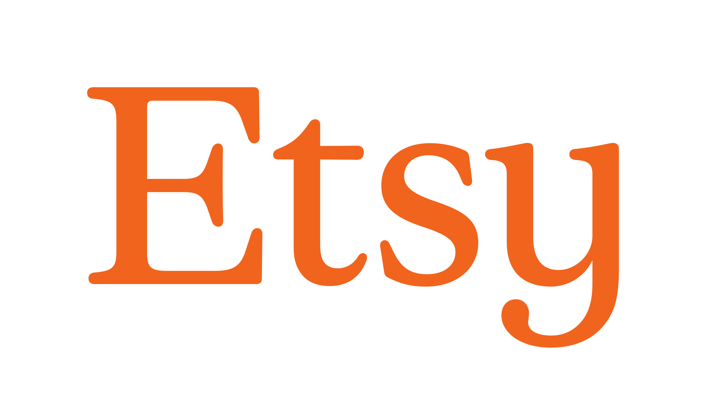
      <span class="partners-logo-fallback">Etsy</span>
    </div>

    <div class="partners-logo-row">
      
      <span class="partners-logo-fallback">Wayfair</span>

      
      <span class="partners-logo-fallback">Target</span>

      
      <span class="partners-logo-fallback">Walmart</span>

    </div>
  </div>

  <div class="flexibility-section">
    <h2>유연성, 보안, 확장성을 고려한 설계</h2>
    <p>
      에이전틱 커머스에는 상호 운용성이 필요합니다. UCP는 업계 표준 위에 만들어졌습니다. REST와 JSON-RPC 전송 방식을 사용하고,
      <a href="https://ap2-protocol.org/" target="_blank">Agent Payments Protocol (AP2)</a>,
      <a href="https://a2a-protocol.org/latest/" target="_blank">Agent2Agent (A2A)</a>,
      <a href="https://modelcontextprotocol.io/docs/getting-started/intro" target="_blank">Model Context Protocol (MCP)</a>
      지원을 기본으로 내장하고 있어 서로 다른 시스템이 맞춤 통합 없이 함께 동작할 수 있습니다.
    </p>
  </div>

  <div class="features-list">

    <div class="feature-item">
      <div class="feature-item-icon">
        
      </div>
      <div>
        <h3>확장 가능하고 보편적</h3>
        <p>
          특정 화면에 얽매이지 않도록 설계해, 소규모 비즈니스부터 엔터프라이즈까지 모든 커머스 주체를 채팅, 비주얼 커머스, 음성 등 모든 모달리티에서 지원할 수 있습니다.
        </p>
      </div>
    </div>

    <div class="feature-item">
      <div class="feature-item-icon">
        
      </div>
      <div>
        <h3>비즈니스 중심</h3>
        <p>
          원활한 커머스를 위해 설계되었습니다. 리테일러는 비즈니스 규칙에 대한 통제권을 유지하고 기록상 판매자(Merchant of Record)로 남아 고객 관계를 온전히 소유합니다.
        </p>
      </div>
    </div>

    <div class="feature-item">
      <div class="feature-item-icon">
        
      </div>
      <div>
        <h3>개방적이고 확장 가능</h3>
        <p>
          설계 단계부터 개방적이고 확장 가능하게 만들어, 여러 분야에 걸쳐 커뮤니티가 주도해 기능과 확장을 개발할 수 있습니다.
        </p>
      </div>
    </div>

    <div class="feature-item">
      <div class="feature-item-icon">
        
      </div>
      <div>
        <h3>안전하고 프라이빗</h3>
        <p>
          계정 연결(OAuth 2.0)에도, 결제 위임(Mandate)과 검증 가능한 자격 증명을 활용한 안전한 결제(AP2)에도 검증된 보안 표준을 사용합니다.
        </p>
      </div>
    </div>

    <div class="feature-item">
      <div class="feature-item-icon">
        
      </div>
      <div>
        <h3>마찰 없는 결제</h3>
        <p>
          제공업체 간에 상호 운용되는 개방형 월렛 생태계로, 구매자는 원하는 결제 수단을 사용할 수 있습니다.
        </p>
      </div>
    </div>

  </div>

  <section class="action-carousel-section">
    <h2>실제 동작 살펴보기</h2>
    <p>
      UCP는 초기 상품 디스커버리와 검색부터 최종 판매, 구매 후 지원까지 커머스 수명 주기 전체를 원활하게 이어 주도록 설계되었습니다.
  프로토콜의 첫 출시는 체크아웃, 신원 연결, 주문 관리라는 세 가지 핵심 기능에 집중합니다.
    </p>
    <div class="carousel-tabs">
      <button class="tab-btn active" onclick="openTab(event, 'tab-checkout')">체크아웃</button>
      <button class="tab-btn" onclick="openTab(event, 'tab-identity')">신원 연결</button>
      <button class="tab-btn" onclick="openTab(event, 'tab-order')">주문</button>
    </div>

    <div class="carousel-content">
      <div id="tab-checkout" class="tab-pane active">
        <div class="pane-text">
          <div class="icon-placeholder">
            
          </div>
          <div class="pane-eyebrow">실제 동작 살펴보기</div>
          <h3>체크아웃</h3>
          <p>통합된 체크아웃 세션 하나로 수백만 비즈니스의 복잡한 장바구니 로직, 동적 가격 책정, 세금 계산 등을 지원합니다.</p>
          <a href="specification/checkout-rest/" class="learn-more-btn">자세히 알아보기</a>
        </div>
        <div class="pane-visuals">
          <div class="image-container">
            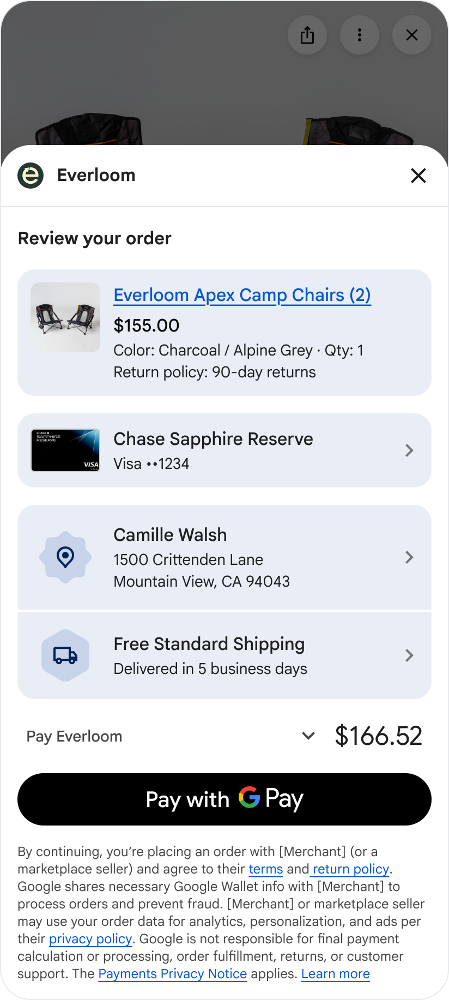
          </div>
          <div class="code-block-placeholder">

  ```json {.yaml .no-copy}
  {
    "ucp": { ... },
    "id": "chk_123456789",
    "status": "ready_for_complete",
    "currency": "USD",
    "buyer": {
      "email": "e.beckett@example.com",
      "first_name": "Elisa",
      "last_name": "Beckett"
    },
    "line_items": [
      {
        "id": "li_1",
        "item": {
          "id": "item_123",
          "title": "Monos Carry-On Pro suitcase",
          "price": 26550
        },
        "quantity": 1,
        ...
      }
    ],
    "totals": [ ... ],
    "links": [ ... ],
    "payment": { ... },
    "fulfillment": {
      "methods": [
        {
          "id": "method_1",
          "type": "shipping",
          "line_item_ids": ["li_1"],
          "selected_destination_id": "dest_1",
          "destinations": [
            {
              "id": "dest_1",
              "first_name": "Elisa",
              "last_name": "Beckett",
              "street_address": "1600 Amphitheatre Pkwy",
              "address_locality": "Mountain View",
              "address_region": "CA",
              "postal_code": "94043",
              "address_country": "US"
            }
          ],
          "groups": [
            {
              "id": "group_1",
              "line_item_ids": ["li_1"],
              "selected_option_id": "free-shipping",
              "options": [
                {
                  "id": "free-shipping",
                  "title": "Free Shipping",
                  "totals": [ {"type": "total", "amount": 0} ]
                }
              ]
            }
          ]
        }
      ]
    }
  }
  ```

          </div>
        </div>
      </div>
      <div id="tab-identity" class="tab-pane">
        <div class="pane-text">
          <div class="icon-placeholder">
            
          </div>
          <div class="pane-eyebrow">실제 동작 살펴보기</div>
          <h3>신원 연결</h3>
          <p>에이전트는 OAuth 2.0 표준을 사용해 자격 증명을 공유하지 않고도 안전하게 인가된 관계를 유지할 수 있습니다.</p>
          <a href="specification/identity-linking/" class="learn-more-btn">자세히 알아보기</a>
        </div>
        <div class="pane-visuals">
          <div class="image-container">
            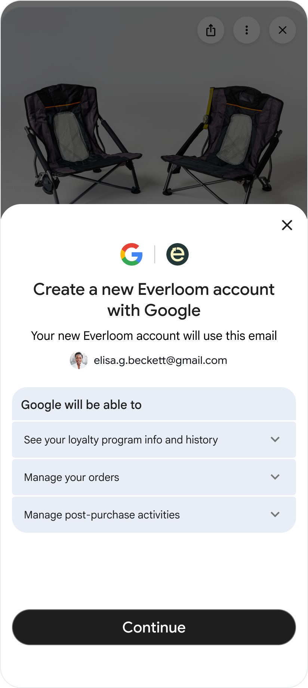
          </div>
          <div class="code-block-placeholder">

  ```json {.yaml .no-copy}
  Sample of /.well-known/oauth-authorization-server

  {
    "issuer": "https://example.com",
    "authorization_endpoint": "https://example.com/oauth2/authorize",
    "token_endpoint": "https://example.com/oauth2/token",
    "revocation_endpoint": "https://example.com/oauth2/revoke",
    "scopes_supported": [
      "dev.ucp.shopping.checkout"
    ],
    "response_types_supported": [
      "code"
    ],
    "grant_types_supported": [
      "authorization_code",
      "refresh_token"
    ],
    "token_endpoint_auth_methods_supported": [
      "client_secret_basic"
    ],
    "service_documentation": "https://example.com/docs/oauth2"
  }
  ```

          </div>
        </div>
      </div>
      <div id="tab-order" class="tab-pane">
        <div class="pane-text">
            <div class="icon-placeholder">
              
          </div>
          <div class="pane-eyebrow">실제 동작 살펴보기</div>
          <h3>주문</h3>
          <p>구매 확인부터 배송까지. 실시간 웹훅으로 모든 채널에서 상태 업데이트, 배송 추적, 반품 처리를 지원합니다.</p>
          <a href="specification/order/" class="learn-more-btn">자세히 알아보기</a>
        </div>
        <div class="pane-visuals">
          <div class="image-container">
            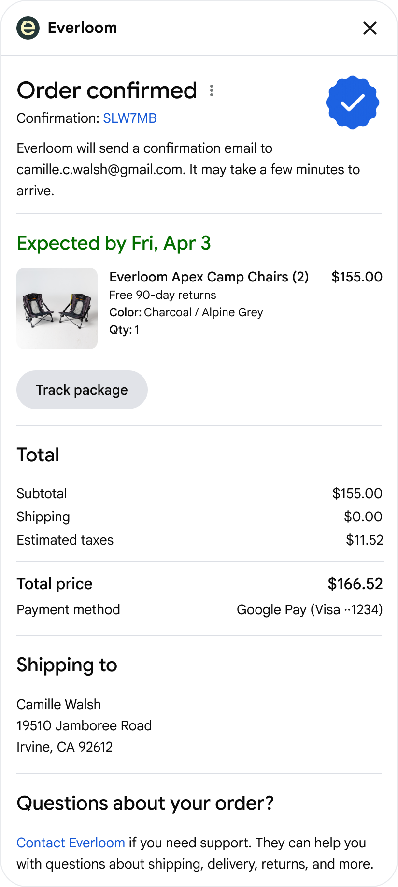
          </div>
          <div class="code-block-placeholder">

  ```json {.yaml .no-copy}
  {
    "ucp": { ... },
    "id": "order_123456789",
    "checkout_id": "chk_123456789",
    "permalink_url": ...,
    "line_items": [ ... ],
    "fulfillment": {
      "expectations": [
        {
          "id": "exp_1",
          "line_items": [{ "id": "li_1", "quantity": 1 }],
          "method_type": "shipping",
          "destination": {
            "first_name": "Elisa",
            "last_name": "Beckett",
            "street_address": "1600 Amphitheatre Pkwy",
            "address_locality": "Mountain View",
            "address_region": "CA",
            "postal_code": "94043",
            "address_country": "US"
          },
          "description": "Arrives in 2-3 business days",
          "fulfillable_on": "now"
        }
        ...
      ],
      "events": [
        {
          "id": "evt_1",
          "occurred_at": "2026-01-11T10:30:00Z",
          "type": "delivered",
          "line_items": [{ "id": "li_1", "quantity": 1 }],
          "tracking_number": "123456789",
          "tracking_url": "https://fedex.com/track/123456789",
          "description": "Delivered to front door"
        }
      ]
    },
    "adjustments": [
      {
        "id": "adj_1",
        "type": "refund",
        "occurred_at": "2026-01-12T14:30:00Z",
        "status": "completed",
        "line_items": [{ "id": "li_1", "quantity": -1 }],
        "totals": [{ "type": "total", "amount": -26550 }],
        "description": "Defective item"
      }
    ],
    "totals": [ ... ]
  }
  ```

          </div>
        </div>
      </div>
    </div>
  </section>

  <script>
  function openTab(evt, tabName) {
    var i, tabContent, tabButtons;
    tabContent = document.getElementsByClassName("tab-pane");
    for (i = 0; i < tabContent.length; i++) {
      tabContent[i].classList.remove("active");
    }
    tabButtons = document.getElementsByClassName("tab-btn");
    for (i = 0; i < tabButtons.length; i++) {
      tabButtons[i].classList.remove("active");
    }
    document.getElementById(tabName).classList.add("active");
    evt.currentTarget.classList.add("active");
  }
  </script>

  <div class="two-column-promo">

    <div class="two-column-promo-item">
      <div class="two-column-promo-item-icon-wrapper">
        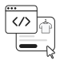
      </div>
      <h3>네이티브 체크아웃 구현</h3>
      <p>
        판매자의 체크아웃 API와 직접 통합하고 협상해, 플랫폼에 맞는 네이티브 UI와 워크플로를 구현합니다.
      </p>
      <a href="specification/checkout-rest/" class="promo-button">작동 방식 보기</a>
    </div>

    <div class="two-column-promo-item">
      <div class="two-column-promo-item-icon-wrapper">
        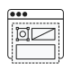
      </div>
      <h3>비즈니스 체크아웃 임베드</h3>
      <p>
        비즈니스의 체크아웃 UI를 임베드하고 렌더링해 복잡한 체크아웃 흐름을 지원합니다. 양방향 통신, 결제 및 배송지 위임 같은 고급 기능을 제공합니다.
      </p>
      <a href="specification/embedded-checkout/" class="promo-button">자세히 알아보기</a>
    </div>

  </div>

  <div class="lifecycle-container">

    <h2>커머스 생태계 전체를 위한 설계</h2>

    <div class="lifecycle-container-row">
      <div class="lifecycle-container-item">
        <div class="lifecycle-container-item-img-wrapper">
          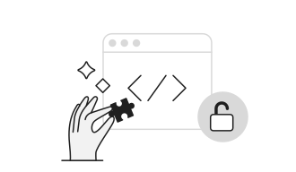
        </div>
        <h3>개발자</h3>
        <p>
          개방된 기반 위에서 커머스의 미래를 만들어 보세요. 차세대 디지털 커머스를 위해 설계된 오픈소스 표준을 함께 발전시켜 나갈 커뮤니티에 참여하세요.
        </p>
        <a href="specification/overview/" class="lifecycle-container-item-link">기술 명세 보기</a>
      </div>
      <div class="lifecycle-container-item">
        <div class="lifecycle-container-item-img-wrapper">
          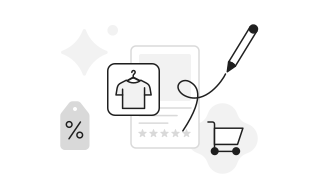
        </div>
        <h3>비즈니스</h3>
        <p>
          UCP를 사용하면 리테일러는 채널마다 체크아웃을 새로 만들지 않고도 AI 어시스턴트, 쇼핑 에이전트, 임베디드 경험 등 고객이 있는 곳 어디서든 고객을 만날 수 있습니다. 비즈니스는 계속 기록상 판매자로 남고, 비즈니스 로직도 그대로 유지됩니다.
        </p>
        <a href="https://developers.google.com/merchant/ucp/" target="_blank" class="lifecycle-container-item-link">UCP와 통합하기</a>
      </div>
    </div>
    <div class="lifecycle-container-row">
      <div class="lifecycle-container-item">
        <div class="lifecycle-container-item-img-wrapper">
          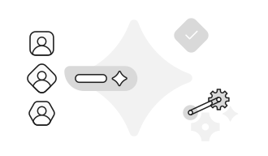
        </div>
        <h3>AI 플랫폼</h3>
        <p>
          표준화된 API로 비즈니스 온보딩을 간소화하고, 사용자에게 통합된 쇼핑 경험을 제공합니다. MCP, A2A, 기존 에이전트 프레임워크와 호환됩니다.
        </p>
        <a href="documentation/core-concepts/" class="lifecycle-container-item-link">UCP 핵심 개념 자세히 알아보기</a>
      </div>
      <div class="lifecycle-container-item">
        <div class="lifecycle-container-item-img-wrapper">
          
        </div>
        <h3>결제 제공업체</h3>
        <p>
          증명 가능한 범용 결제. 모든 승인은 사용자 동의를 입증하는 암호학적 증명으로 뒷받침됩니다. 개방적이고 모듈화된 결제 핸들러 설계로 열린 상호 운용성과 결제 수단 선택권을 제공합니다.
        </p>
        <a href="documentation/ucp-and-ap2/" class="lifecycle-container-item-link">UCP와 AP2 자세히 알아보기</a>
      </div>

    </div>
  </div>

  <div class="partner-carousel">
    <h2>생태계 전반의 지지</h2>

    <div class="partner-track">
      <div class="partner-logo">
        
        <span>Adyen</span>
      </div>
      <div class="partner-logo">
        
        <span>Affirm</span>
      </div>
      <div class="partner-logo">
        
        <span>Amex</span>
      </div>
      <div class="partner-logo">
        
        <span>Ant International</span>
      </div>
      <div class="partner-logo">
        
        <span>Best Buy</span>
      </div>
      <div class="partner-logo">
        
        <span>Block</span>
      </div>
      <div class="partner-logo">
        
        <span>Carrefour</span>
      </div>
      <div class="partner-logo">
        
        <span>Checkout.com</span>
      </div>
      <div class="partner-logo">
        
        <span>Chewy</span>
      </div>
      <div class="partner-logo">
        
        <span>Commerce</span>
      </div>
      <div class="partner-logo">
        
        <span>Fiserv</span>
      </div>
      <div class="partner-logo">
        
        <span>Flipkart</span>
      </div>
      <div class="partner-logo">
        
        <span>Gap</span>
      </div>
      <div class="partner-logo">
        
        <span>Klarna</span>
      </div>
      <div class="partner-logo">
        
        <span>Kroger</span>
      </div>
      <div class="partner-logo">
        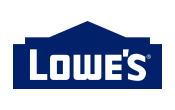
        <span>Lowe's</span>
      </div>
      <div class="partner-logo">
        
        <span>Macy's</span>
      </div>
      <div class="partner-logo">
        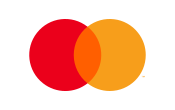
        <span>Mastercard</span>
      </div>
      <div class="partner-logo">
        
        <span>Paypal</span>
      </div>
      <div class="partner-logo">
        
        <span>Salesforce</span>
      </div>
      <div class="partner-logo">
        
        <span>Sephora</span>
      </div>
      <div class="partner-logo">
        
        <span>Shopee</span>
      </div>
      <div class="partner-logo">
        
        <span>Splitit</span>
      </div>
      <div class="partner-logo">
        
        <span>Stripe</span>
      </div>
      <div class="partner-logo">
        
        <span>The Home Depot</span>
      </div>
      <div class="partner-logo">
        
        <span>Ulta</span>
      </div>
      <div class="partner-logo">
        
        <span>Visa</span>
      </div>
      <div class="partner-logo">
        
        <span>Worldpay</span>
      </div>
      <div class="partner-logo">
        
        <span>Zalando</span>
      </div>
      <!-- Duplicated the partner logos to provide a seamless infinite scroll in the carousel-->
      <div class="partner-logo">
        
        <span>Adyen</span>
      </div>
     <div class="partner-logo">
        
        <span>Affirm</span>
      </div>
      <div class="partner-logo">
        
        <span>Amex</span>
      </div>
      <div class="partner-logo">
        
        <span>Ant International</span>
      </div>
      <div class="partner-logo">
        
        <span>Best Buy</span>
      </div>
      <div class="partner-logo">
        
        <span>Block</span>
      </div>
      <div class="partner-logo">
        
        <span>Carrefour</span>
      </div>
      <div class="partner-logo">
        
        <span>Checkout.com</span>
      </div>
      <div class="partner-logo">
        
        <span>Chewy</span>
      </div>
      <div class="partner-logo">
        
        <span>Commerce</span>
      </div>
      <div class="partner-logo">
        
        <span>Fiserv</span>
      </div>
      <div class="partner-logo">
        
        <span>Flipkart</span>
      </div>
      <div class="partner-logo">
        
        <span>Gap</span>
      </div>
      <div class="partner-logo">
        
        <span>Klarna</span>
      </div>
      <div class="partner-logo">
        
        <span>Kroger</span>
      </div>
      <div class="partner-logo">
        
        <span>Lowe's</span>
      </div>
      <div class="partner-logo">
        
        <span>Macy's</span>
      </div>
      <div class="partner-logo">
        
        <span>Mastercard</span>
      </div>
      <div class="partner-logo">
        
        <span>Paypal</span>
      </div>
      <div class="partner-logo">
        
        <span>Salesforce</span>
      </div>
      <div class="partner-logo">
        
        <span>Sephora</span>
      </div>
      <div class="partner-logo">
        
        <span>Shopee</span>
      </div>
      <div class="partner-logo">
        
        <span>Splitit</span>
      </div>
      <div class="partner-logo">
        
        <span>Stripe</span>
      </div>
      <div class="partner-logo">
        
        <span>The Home Depot</span>
      </div>
      <div class="partner-logo">
        
        <span>Ulta</span>
      </div>
      <div class="partner-logo">
        
        <span>Visa</span>
      </div>
      <div class="partner-logo">
        
        <span>Worldpay</span>
      </div>
      <div class="partner-logo">
        
        <span>Zalando</span>
      </div>

    </div>
  </div>

  <div class="get-started-container">

    <div class="get-started-container-intro">
      <h2>지금 시작하기</h2>

      <p>
        UCP는 AI 에이전트, 앱, 비즈니스, 결제 제공업체가 연결마다 일회성 맞춤 통합을 만들지 않고도 매끄럽게 상호작용하도록 설계된 개방형 표준입니다. 커머스의 미래를 함께 만들어 갈 여러분의 피드백과 기여를 기다립니다.
      </p>
      <p>
        전체 기술 명세, 문서, 레퍼런스 구현은 공개 GitHub 저장소에서 확인할 수 있습니다.
      </p>
    </div>

    <div class="get-started-container-steps">
      <div class="get-started-container-step">
        <div class="get-started-container-step-icon-wrapper">
          
        </div>
        <h3><a href="https://github.com/Universal-Commerce-Protocol/samples" target="_blank">다운로드</a></h3>
        <p>코드 샘플을 다운로드해 실행해 보세요</p>
      </div>
      <div class="get-started-container-step">
        <div class="get-started-container-step-icon-wrapper">
          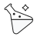
        </div>
        <h3><a href="specification/playground/" target="_blank">실험</a></h3>
        <p>프로토콜과 다양한 에이전트 역할을 직접 실험해 보세요</p>
      </div>
      <div class="get-started-container-step">
        <div class="get-started-container-step-icon-wrapper">
          
        </div>
        <h3><a href="https://github.com/Universal-Commerce-Protocol/.github/blob/main/CONTRIBUTING.md" target="_blank">기여</a></h3>
        <p>공개 저장소에 피드백과 코드를 기여해 주세요</p>
      </div>
    </div>
    <div class="get-started-container-repo-link">
      <a href="https://github.com/Universal-Commerce-Protocol/ucp" target="_blank" class="promo-button">
        <svg height="24" width="24" viewBox="0 0 16 16" version="1.1" fill="currentColor">
          <path d="M8 0C3.58 0 0 3.58 0 8c0 3.54 2.29 6.53 5.47 7.59.4.07.55-.17.55-.38 0-.19-.01-.82-.01-1.49-2.01.37-2.53-.49-2.69-.94-.09-.23-.48-.94-.82-1.13-.28-.15-.68-.52-.01-.53.63-.01 1.08.58 1.23.82.72 1.21 1.87.87 2.33.66.07-.52.28-.87.51-1.07-1.78-.2-3.64-.89-3.64-3.95 0-.87.31-1.59.82-2.15-.08-.2-.36-1.02.08-2.12 0 0 .67-.21 2.2.82.64-.18 1.32-.27 2-.27.68 0 1.36.09 2 .27 1.53-1.04 2.2-.82 2.2-.82.44 1.1.16 1.92.08 2.12.51.56.82 1.27.82 2.15 0 3.07-1.87 3.75-3.65 3.95.29.25.54.73.54 1.48 0 1.07-.01 1.93-.01 2.2 0 .21.15.46.55.38A8.013 8.013 0 0016 8c0-4.42-3.58-8-8-8z"></path>
        </svg>
        GitHub 저장소 방문하기
      </a>
    </div>

  </div>
</div>
