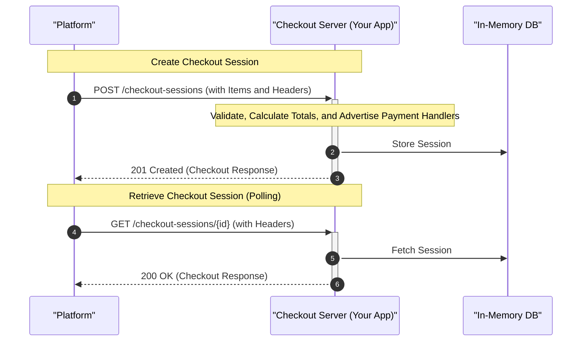

<!-- cspell:ignore uuidv4 uuidv autonumber -->

# UCP 시작하기 { #getting-started-with-ucp }

이 가이드에서는 기본적인 Universal Commerce Protocol(UCP) 서버를 만드는 과정을 단계별로 안내합니다. 공식 [Python SDK](https://github.com/Universal-Commerce-Protocol/python-sdk)와 [TypeScript SDK](https://github.com/Universal-Commerce-Protocol/js-sdk)를 사용한 **Python(FastAPI)** 예시와 **Node.js(Express)** 예시를 모두 제공합니다.

플랫폼이 체크아웃 세션을 시작하고 조회할 수 있는 간단한 체크아웃 서버를 만들어 봅니다.

## 사전 요구 사항 { #prerequisites }

=== "Python"

    * Python 3.10 이상이 설치되어 있어야 합니다.
    * FastAPI와 Pydantic의 기본 지식이 필요합니다.
    * 패키지 관리에는 [`uv`](https://docs.astral.sh/uv/)를 권장합니다.

=== "Node.js"

    * Node.js 18 이상이 설치되어 있어야 합니다.
    * Express와 Zod의 기본 지식이 필요합니다.

---

## 프로젝트 설정 { #project-setup }

=== "Python"

    새 디렉터리를 만들고 프로젝트를 초기화합니다.

    ```bash
    mkdir ucp-quickstart-python
    cd ucp-quickstart-python
    uv init
    ```

    필요한 의존성을 추가합니다. [`ucp-sdk`](https://github.com/Universal-Commerce-Protocol/python-sdk)에는 UCP 스키마에서 생성한 Pydantic 모델이 들어 있습니다.

    !!! note
        Python SDK 패키지는 PyPI에 `ucp-sdk`로 등록되어 있지만, Python 코드에서는 `ucp_sdk`(밑줄 사용)로 임포트합니다.

    ```bash
    uv add fastapi uvicorn ucp-sdk
    ```

=== "Node.js"

    새 디렉터리를 만들고 프로젝트를 초기화합니다.

    ```bash
    mkdir ucp-quickstart-nodejs
    cd ucp-quickstart-nodejs
    npm init -y
    ```

    `package.json`에 `"type": "module"`을 추가해 ES 모듈을 쓰도록 설정합니다.

    필요한 의존성을 추가합니다. [`@ucp-js/sdk`](https://github.com/Universal-Commerce-Protocol/js-sdk)에는 TypeScript 타입과 Zod 스키마가 들어 있습니다.

    ```bash
    npm install express uuid @ucp-js/sdk
    npm install --save-dev typescript @types/express @types/node tsx
    ```

    TypeScript 설정을 초기화합니다.

    ```bash
    npx tsc --init
    ```

---

## 서버 구현 { #implementing-the-server }

서버를 단계별로 구현해 봅니다. 서버가 처리해야 하는 요청은 다음과 같습니다.

1. **체크아웃 생성(`POST /checkout-sessions`)**: 구매할 상품을 받아, 합계와 사용 가능한 결제 핸들러를 담은 체크아웃 세션을 반환합니다.
2. **체크아웃 조회(`GET /checkout-sessions/{id}`)**: 플랫폼이 세션 상태를 폴링할 수 있게 합니다.

### 전체 흐름 { #high-level-flow }

체크아웃 과정에서 각 구성 요소가 주고받는 흐름은 다음과 같습니다.



### 엔드투엔드 흐름에서의 위치 { #how-it-fits-into-the-e2e-flow }

전체 UCP 통합은 다음 단계로 진행됩니다.

1. **디스커버리:** 플랫폼이 `/.well-known/ucp`에 있는 UCP 디스커버리 프로필을 가져와 `/checkout-sessions` 같은 UCP 엔드포인트를 찾습니다.
2. **체크아웃 생성(이 가이드에서 구현):** 플랫폼이 사용자가 구매하려는 상품으로 체크아웃 세션을 시작합니다.
3. **체크아웃 갱신:** 플랫폼이 구매자 정보(예: 배송지 주소, 이메일)로 체크아웃 세션을 갱신해 최종 세금과 배송 옵션을 계산합니다.
4. **체크아웃 완료:** 플랫폼이 결제 자격 증명을 제출해 주문을 확정합니다.

이 가이드에서는 2단계(체크아웃 생성)와, 생성한 체크아웃 세션의 상태 조회를 다룹니다.

### 1. 임포트와 설정 { #1-imports-and-setup }

애플리케이션을 초기화하고 세션을 저장할 인메모리 데이터베이스를 정의합니다.

=== "Python"

    ```python
    # main.py
    import uuid
    from typing import Annotated
    from fastapi import FastAPI, Header, HTTPException, status

    # Import UCP SDK models
    from ucp_sdk.models.schemas.ucp import ResponseCheckoutSchema
    from ucp_sdk.models.schemas.shopping.checkout import Checkout
    from ucp_sdk.models.schemas.shopping.checkout_create_request import CheckoutCreateRequest
    from ucp_sdk.models.schemas.shopping.types.line_item import LineItem
    from ucp_sdk.models.schemas.shopping.types.item import Item
    from ucp_sdk.models.schemas.common.types.totals import Total
    from ucp_sdk.models.schemas.common.types.link import Link
    from ucp_sdk.models.schemas.common.types.available_payment_instrument import AvailablePaymentInstrument
    from ucp_sdk.models.schemas.payment_handler import ResponseSchema as PaymentHandlerResponse

    # Initialize FastAPI app
    app = FastAPI(title="UCP Quickstart Server")

    # Simple in-memory database
    checkout_sessions = {}
    ```

=== "Node.js"

    ```typescript
    // server.ts
    import express from 'express';
    import { v4 as uuidv4 } from 'uuid';

    // Import validation schemas from JS SDK
    import {
      CheckoutCreateRequestSchema,
      CheckoutResponseSchema,
      type CheckoutResponse
    } from '@ucp-js/sdk';

    // Initialize Express app
    const app = express();
    app.use(express.json());

    // Simple in-memory database
    const checkoutSessions: Record<string, CheckoutResponse> = {};
    ```

### 2. 체크아웃 생성 엔드포인트(라우트와 헤더 검증) { #2-create-checkout-endpoint-route-header-validation }

체크아웃 세션을 생성하는 엔드포인트를 정의합니다. UCP에서는 `Idempotency-Key`와 `UCP-Agent` 헤더가 필수입니다.

=== "Python"

    ```python
    # main.py
    @app.post(
        "/checkout-sessions",
        response_model=Checkout,
        status_code=status.HTTP_201_CREATED,
        response_model_exclude_none=True
    )
    async def create_checkout(
        body: CheckoutCreateRequest,
        idempotency_key: Annotated[str, Header(alias="Idempotency-Key")],
        ucp_agent: Annotated[str, Header(alias="UCP-Agent")]
    ):
        """Create a new UCP checkout session."""
        # Note: In a production environment, you must use the Idempotency-Key
        # to prevent duplicate processing of the same request.

        # Generate a unique checkout session ID
        session_id = f"chk_{uuid.uuid4().hex[:10]}"
    ```

=== "Node.js"

    ```typescript
    // server.ts
    app.post('/checkout-sessions', (req, res) => {
      // 1. Validate required UCP headers
      const idempotencyKey = req.header('Idempotency-Key');
      const ucpAgent = req.header('UCP-Agent');

      if (!idempotencyKey || !ucpAgent) {
        return res.status(400).json({
          error: 'Missing required headers (Idempotency-Key, UCP-Agent)'
        });
      }

      // 2. Validate request body against UCP schema using Zod
      const validation = CheckoutCreateRequestSchema.safeParse(req.body);
      if (!validation.success) {
        return res.status(400).json({ errors: validation.error.errors });
      }

      const body = validation.data;

      // Generate a unique checkout session ID
      const sessionId = `chk_${uuidv4().replace(/-/g, '').substring(0, 10)}`;
    ```

!!! note
    필수 UCP 헤더가 없으면 FastAPI(Python)는 내장 검증 기능으로 **HTTP 422 Unprocessable Entity** 오류를 자동 반환합니다. Express(Node.js) 구현에서는 **HTTP 400 Bad Request** 오류를 직접 반환합니다. 이 퀵스타트는 단순화를 위해 헤더 누락, 검증 실패, `404` 응답에 일반 JSON 오류(`{"error": "..."}` 또는 FastAPI의 `{"detail": "..."}` 등)를 반환합니다. 프로덕션 서버는 반드시 명세의 표준 오류 형식을 반환해야 합니다([오류 응답](shopping/checkout/rest.md#error-responses)과 [핵심 명세 — 오류 처리](overview/index.md#error-handling) 참고).

### 3. 비즈니스 로직(상품 처리와 합계 계산) { #3-business-logic-process-items-calculate-totals }

들어온 라인 아이템을 처리해 가격을 확정하고 소계, 세금, 합계를 계산합니다. 가격은 항상 **최소 화폐 단위**(예: USD는 센트)로 표기합니다.

=== "Python"

    ```python
    # main.py
        # Map input line items to output line items with pricing
        output_line_items = []
        subtotal = 0
        tax = 0

        for index, item_req in enumerate(body.line_items):
            # Mock product database lookup
            # In production, perform real-time inventory verification and stock
            # reservation here (catalog availability signals are advisory and can drift).
            price = 2500  # $25.00 in minor units (cents)
            title = f"Flower Bouquet {item_req.item.id}"
            item_subtotal = price * item_req.quantity
            item_tax = int(item_subtotal * 0.08)  # 8% tax
            item_total = item_subtotal + item_tax

            subtotal += item_subtotal
            tax += item_tax

            output_line_items.append(
                LineItem(
                    id=f"li_{index}",
                    item=Item(id=item_req.item.id, title=title, price=price),
                    quantity=item_req.quantity,
                    totals=[
                        Total(type="subtotal", amount=item_subtotal),
                        Total(type="tax", amount=item_tax),
                        Total(type="total", amount=item_total)
                    ]
                )
            )

        total = subtotal + tax
    ```

=== "Node.js"

    ```typescript
    // server.ts
      // Map input line items to output line items with pricing
      const outputLineItems = body.line_items.map((item, index) => {
        // Mock product database lookup
        // In production, perform real-time inventory verification and stock
        // reservation here (catalog availability signals are advisory and can drift).
        const price = 2500; // $25.00 in minor units (cents)
        const title = `Flower Bouquet ${item.item.id}`;
        const itemSubtotal = price * item.quantity;
        const itemTax = Math.floor(itemSubtotal * 0.08); // 8% tax
        const itemTotal = itemSubtotal + itemTax;

        return {
          id: `li_${index}`,
          item: { id: item.item.id, title, price },
          quantity: item.quantity,
          totals: [
            { type: 'subtotal', amount: itemSubtotal },
            { type: 'tax', amount: itemTax },
            { type: 'total', amount: itemTotal }
          ]
        };
      });

      // Calculate order totals from line items
      const subtotal = outputLineItems.reduce((acc, item) => {
        const subtotalEntry = item.totals.find(t => t.type === 'subtotal');
        return acc + (subtotalEntry ? subtotalEntry.amount : 0);
      }, 0);
      const tax = outputLineItems.reduce((acc, item) => {
        const taxEntry = item.totals.find(t => t.type === 'tax');
        return acc + (taxEntry ? taxEntry.amount : 0);
      }, 0);
      const total = subtotal + tax;
    ```

### 4. UCP 응답 구성 { #4-ucp-response-construction }

지원하는 결제 핸들러를 알리는 UCP 메타데이터 블록을 만들고, 최종 체크아웃 응답을 조립합니다.

!!! note "기능 협상"
    프로덕션에서 비즈니스는 `UCP-Agent` 헤더로 플랫폼의 프로필을 확인하고, 양쪽이 지원하는 기능의 교집합을 계산해 협상된 활성 기능 집합을 `capabilities`에 담아 반환합니다. 이 퀵스타트에서는 단순화를 위해 전체 기능 협상을 생략합니다. 자세한 내용은 [디스커버리와 기능 협상](../documentation/core-concepts.md#discovery-capability-negotiation)을 참고하세요.

=== "Python"

    ```python
    # main.py
        # Configure available payment handlers.
        # We advertise support for a generic mock payment handler.
        payment_handlers = {
            "com.example.mock_pay": [
                PaymentHandlerResponse(
                    id="mock_pay_handler_1",
                    version="2026-08-25",
                    available_instruments=[
                        AvailablePaymentInstrument(type="mock_instrument")
                    ]
                )
            ]
        }

        # Construct UCP protocol metadata
        # (In production, populate active capabilities from UCP-Agent negotiation)
        ucp_metadata = ResponseCheckoutSchema(
            version="2026-08-25",
            status="success",
            payment_handlers=payment_handlers
        )

        # Assemble the final Checkout payload
        checkout = Checkout(
            ucp=ucp_metadata,
            id=session_id,
            status="incomplete",
            currency="USD",
            line_items=output_line_items,
            totals=[
                Total(type="subtotal", amount=subtotal),
                Total(type="tax", amount=tax),
                Total(type="total", amount=total)
            ],
            links=[
                Link(type="terms_of_service", url="https://example.com/terms"),
                Link(type="privacy_policy", url="https://example.com/privacy")
            ]
        )

        # Save to database and return
        checkout_sessions[session_id] = checkout
        return checkout
    ```

=== "Node.js"

    ```typescript
    // server.ts
      // Configure available payment handlers.
      // We advertise support for a generic mock payment handler.
      const ucpMetadata = {
        version: '2026-08-25',
        status: 'success' as const,
        capabilities: {}, // In production, populate via capability negotiation from UCP-Agent
        payment_handlers: {
          'com.example.mock_pay': [
            {
              id: 'mock_pay_handler_1',
              version: '2026-08-25',
              available_instruments: [
                { type: 'mock_instrument' }
              ]
            }
          ]
        }
      };

      // Assemble the final Checkout payload
      const checkout: CheckoutResponse = {
        ucp: ucpMetadata,
        id: sessionId,
        status: 'incomplete',
        currency: 'USD',
        line_items: outputLineItems,
        totals: [
          { type: 'subtotal', amount: subtotal },
          { type: 'tax', amount: tax },
          { type: 'total', amount: total }
        ],
        links: [
          { type: 'terms_of_service', url: 'https://example.com/terms' },
          { type: 'privacy_policy', url: 'https://example.com/privacy' }
        ]
      };

      // Validate output matches CheckoutResponse schema before sending
      const outputValidation = CheckoutResponseSchema.safeParse(checkout);
      if (!outputValidation.success) {
        console.error('Output validation failed:', outputValidation.error);
        return res.status(500).json({ error: 'Internal server error' });
      }

      // Save to database and return
      checkoutSessions[sessionId] = checkout;
      res.status(201).json(checkout);
    });
    ```

### 5. 체크아웃 조회 엔드포인트 { #5-get-checkout-endpoint }

플랫폼이 체크아웃 상태를 가져올 수 있도록 조회 라우트를 구현합니다. [UCP 헤더 요구 사항](shopping/checkout/rest.md#specific-header-requirements)에 따라 UCP는 생성·갱신·완료 같은 변경 작업뿐 아니라 모든 요청에 `UCP-Agent` 헤더를 요구합니다.

=== "Python"

    ```python
    # main.py
    @app.get(
        "/checkout-sessions/{id}",
        response_model=Checkout,
        response_model_exclude_none=True
    )
    async def get_checkout(
        id: str,
        ucp_agent: Annotated[str, Header(alias="UCP-Agent")]
    ):
        """Retrieve an existing checkout session."""
        if id not in checkout_sessions:
            raise HTTPException(status_code=404, detail="Checkout session not found")
        return checkout_sessions[id]
    ```

=== "Node.js"

    ```typescript
    // server.ts
    app.get('/checkout-sessions/:id', (req, res) => {
      // 1. Validate required UCP headers
      const ucpAgent = req.header('UCP-Agent');
      if (!ucpAgent) {
        return res.status(400).json({
          error: 'Missing required header (UCP-Agent)'
        });
      }

      const session = checkoutSessions[req.params.id];
      if (!session) {
        return res.status(404).json({ error: 'Checkout session not found' });
      }
      res.json(session);
    });

    const PORT = 3000;
    app.listen(PORT, () => {
      console.log(`Server is running on port ${PORT}`);
    });
    ```

---

## 서버 실행 { #running-the-server }

=== "Python"

    Uvicorn으로 서버를 시작합니다.

    ```bash
    uv run uvicorn main:app --port 8080 --reload
    ```

=== "Node.js"

    `package.json`에 start 스크립트를 추가합니다.

    <!-- ucp:example skip reason="package.json snippet" -->
    ```json
    "scripts": {
      "start": "tsx server.ts"
    }
    ```

    서버를 시작합니다.

    ```bash
    npm start
    ```

이제 서버가 `http://127.0.0.1:8080`(Python) 또는 `http://127.0.0.1:3000`(Node.js)에서 실행됩니다.

---

## 서버 테스트 { #testing-the-server }

`curl`로 서버를 테스트해 봅니다.

### 1. 체크아웃 세션 생성 { #1-create-a-checkout-session }

`POST` 요청을 보내 상품 하나로 체크아웃 세션을 생성합니다.

=== "Python"

    ```bash
    curl -X POST http://127.0.0.1:8080/checkout-sessions \
      -H "Content-Type: application/json" \
      -H "Idempotency-Key: test-key-123" \
      -H "UCP-Agent: profile=\"https://platform.example/profile\"" \
      -d '{
        "line_items": [
          {
            "item": {
              "id": "prod_roses"
            },
            "quantity": 2
          }
        ]
      }'
    ```

=== "Node.js"

    ```bash
    curl -X POST http://127.0.0.1:3000/checkout-sessions \
      -H "Content-Type: application/json" \
      -H "Idempotency-Key: test-key-123" \
      -H "UCP-Agent: profile=\"https://platform.example/profile\"" \
      -d '{
        "line_items": [
          {
            "item": {
              "id": "prod_roses"
            },
            "quantity": 2
          }
        ]
      }'
    ```

UCP 메타데이터, 계산된 합계, 설정한 결제 핸들러가 담긴 응답이 돌아옵니다.

<!-- ucp:example skip reason="FastAPI/Express response mock" -->
```json
{
  "ucp": {
    "version": "2026-08-25",
    "status": "success",
    "payment_handlers": {
      "com.example.mock_pay": [
        {
          "version": "2026-08-25",
          "id": "mock_pay_handler_1",
          "available_instruments": [
            {
              "type": "mock_instrument"
            }
          ]
        }
      ]
    }
  },
  "id": "chk_...",
  "line_items": [
    {
      "id": "li_0",
      "item": {
        "id": "prod_roses",
        "title": "Flower Bouquet prod_roses",
        "price": 2500
      },
      "quantity": 2,
      "totals": [
        {
          "type": "subtotal",
          "amount": 5000
        },
        {
          "type": "tax",
          "amount": 400
        },
        {
          "type": "total",
          "amount": 5400
        }
      ]
    }
  ],
  "status": "incomplete",
  "currency": "USD",
  "totals": [
    {
      "type": "subtotal",
      "amount": 5000
    },
    {
      "type": "tax",
      "amount": 400
    },
    {
      "type": "total",
      "amount": 5400
    }
  ],
  "links": [
    {
      "type": "terms_of_service",
      "url": "https://example.com/terms"
    },
    {
      "type": "privacy_policy",
      "url": "https://example.com/privacy"
    }
  ]
}
```

### 2. 체크아웃 세션 조회 { #2-retrieve-the-checkout-session }

이전 단계에서 반환된 `id`로 세션을 조회합니다.

=== "Python"

    ```bash
    curl "http://127.0.0.1:8080/checkout-sessions/<replace-with-your-checkout-id>" \
      -H "UCP-Agent: profile=\"https://platform.example/profile\""
    ```

=== "Node.js"

    ```bash
    curl "http://127.0.0.1:3000/checkout-sessions/<replace-with-your-checkout-id>" \
      -H "UCP-Agent: profile=\"https://platform.example/profile\""
    ```

---

## 전체 파일 참고 { #full-file-reference }

아래 섹션을 펼치면 전체 파일 코드를 볼 수 있습니다.

??? "전체 코드 참고"

    === "Python"

        `main.py`
        ```python
        # main.py
        import uuid
        from typing import Annotated
        from fastapi import FastAPI, Header, HTTPException, status

        # Import UCP SDK models
        from ucp_sdk.models.schemas.ucp import ResponseCheckoutSchema
        from ucp_sdk.models.schemas.shopping.checkout import Checkout
        from ucp_sdk.models.schemas.shopping.checkout_create_request import CheckoutCreateRequest
        from ucp_sdk.models.schemas.shopping.types.line_item import LineItem
        from ucp_sdk.models.schemas.shopping.types.item import Item
        from ucp_sdk.models.schemas.common.types.totals import Total
        from ucp_sdk.models.schemas.common.types.link import Link
        from ucp_sdk.models.schemas.common.types.available_payment_instrument import AvailablePaymentInstrument
        from ucp_sdk.models.schemas.payment_handler import ResponseSchema as PaymentHandlerResponse

        # Initialize FastAPI app
        app = FastAPI(title="UCP Quickstart Server")

        # Simple in-memory database
        checkout_sessions = {}

        @app.post(
            "/checkout-sessions",
            response_model=Checkout,
            status_code=status.HTTP_201_CREATED,
            response_model_exclude_none=True
        )
        async def create_checkout(
            body: CheckoutCreateRequest,
            idempotency_key: Annotated[str, Header(alias="Idempotency-Key")],
            ucp_agent: Annotated[str, Header(alias="UCP-Agent")]
        ):
            """Create a new UCP checkout session."""
            # Note: In a production environment, you must use the Idempotency-Key
            # to prevent duplicate processing of the same request.

            # Generate a unique checkout session ID
            session_id = f"chk_{uuid.uuid4().hex[:10]}"

            # Map input line items to output line items with pricing
            output_line_items = []
            subtotal = 0
            tax = 0

            for index, item_req in enumerate(body.line_items):
                # Mock product database lookup
                # In production, perform real-time inventory verification and stock
                # reservation here (catalog availability signals are advisory and can drift).
                price = 2500  # $25.00 in minor units (cents)
                title = f"Flower Bouquet {item_req.item.id}"
                item_subtotal = price * item_req.quantity
                item_tax = int(item_subtotal * 0.08)  # 8% tax
                item_total = item_subtotal + item_tax

                subtotal += item_subtotal
                tax += item_tax

                output_line_items.append(
                    LineItem(
                        id=f"li_{index}",
                        item=Item(id=item_req.item.id, title=title, price=price),
                        quantity=item_req.quantity,
                        totals=[
                            Total(type="subtotal", amount=item_subtotal),
                            Total(type="tax", amount=item_tax),
                            Total(type="total", amount=item_total)
                        ]
                    )
                )

            total = subtotal + tax

            # Configure available payment handlers.
            # We advertise support for a generic mock payment handler.
            payment_handlers = {
                "com.example.mock_pay": [
                    PaymentHandlerResponse(
                        id="mock_pay_handler_1",
                        version="2026-08-25",
                        available_instruments=[
                            AvailablePaymentInstrument(type="mock_instrument")
                        ]
                    )
                ]
            }

            # Construct UCP protocol metadata
            # (In production, populate active capabilities from UCP-Agent negotiation)
            ucp_metadata = ResponseCheckoutSchema(
                version="2026-08-25",
                status="success",
                payment_handlers=payment_handlers
            )

            # Assemble the final Checkout payload
            checkout = Checkout(
                ucp=ucp_metadata,
                id=session_id,
                status="incomplete",
                currency="USD",
                line_items=output_line_items,
                totals=[
                    Total(type="subtotal", amount=subtotal),
                    Total(type="tax", amount=tax),
                    Total(type="total", amount=total)
                ],
                links=[
                    Link(type="terms_of_service", url="https://example.com/terms"),
                    Link(type="privacy_policy", url="https://example.com/privacy")
                ]
            )

            # Save to database and return
            checkout_sessions[session_id] = checkout
            return checkout

        @app.get(
            "/checkout-sessions/{id}",
            response_model=Checkout,
            response_model_exclude_none=True
        )
        async def get_checkout(
            id: str,
            ucp_agent: Annotated[str, Header(alias="UCP-Agent")]
        ):
            """Retrieve an existing checkout session."""
            if id not in checkout_sessions:
                raise HTTPException(status_code=404, detail="Checkout session not found")
            return checkout_sessions[id]
        ```

    === "Node.js"

        `server.ts`
        ```typescript
        // server.ts
        import express from 'express';
        import { v4 as uuidv4 } from 'uuid';

        // Import validation schemas from JS SDK
        import {
          CheckoutCreateRequestSchema,
          CheckoutResponseSchema,
          type CheckoutResponse
        } from '@ucp-js/sdk';

        // Initialize Express app
        const app = express();
        app.use(express.json());

        // Simple in-memory database
        const checkoutSessions: Record<string, CheckoutResponse> = {};

        app.post('/checkout-sessions', (req, res) => {
          // 1. Validate required UCP headers
          const idempotencyKey = req.header('Idempotency-Key');
          const ucpAgent = req.header('UCP-Agent');

          if (!idempotencyKey || !ucpAgent) {
            return res.status(400).json({
              error: 'Missing required headers (Idempotency-Key, UCP-Agent)'
            });
          }

          // 2. Validate request body against UCP schema using Zod
          const validation = CheckoutCreateRequestSchema.safeParse(req.body);
          if (!validation.success) {
            return res.status(400).json({ errors: validation.error.errors });
          }

          const body = validation.data;

          // Generate a unique checkout session ID
          const sessionId = `chk_${uuidv4().replace(/-/g, '').substring(0, 10)}`;

          // Map input line items to output line items with pricing
          const outputLineItems = body.line_items.map((item, index) => {
            // Mock product database lookup
            // In production, perform real-time inventory verification and stock
            // reservation here (catalog availability signals are advisory and can drift).
            const price = 2500; // $25.00 in minor units (cents)
            const title = `Flower Bouquet ${item.item.id}`;
            const itemSubtotal = price * item.quantity;
            const itemTax = Math.floor(itemSubtotal * 0.08); // 8% tax
            const itemTotal = itemSubtotal + itemTax;

            return {
              id: `li_${index}`,
              item: { id: item.item.id, title, price },
              quantity: item.quantity,
              totals: [
                { type: 'subtotal', amount: itemSubtotal },
                { type: 'tax', amount: itemTax },
                { type: 'total', amount: itemTotal }
              ]
            };
          });

          // Calculate order totals from line items
          const subtotal = outputLineItems.reduce((acc, item) => {
            const subtotalEntry = item.totals.find(t => t.type === 'subtotal');
            return acc + (subtotalEntry ? subtotalEntry.amount : 0);
          }, 0);
          const tax = outputLineItems.reduce((acc, item) => {
            const taxEntry = item.totals.find(t => t.type === 'tax');
            return acc + (taxEntry ? taxEntry.amount : 0);
          }, 0);
          const total = subtotal + tax;

          // Configure available payment handlers.
          // We advertise support for a generic mock payment handler.
          const ucpMetadata = {
            version: '2026-08-25',
            status: 'success' as const,
            capabilities: {}, // In production, populate via capability negotiation from UCP-Agent
            payment_handlers: {
              'com.example.mock_pay': [
                {
                  id: 'mock_pay_handler_1',
                  version: '2026-08-25',
                  available_instruments: [
                    { type: 'mock_instrument' }
                  ]
                }
              ]
            }
          };

          // Assemble the final Checkout payload
          const checkout: CheckoutResponse = {
            ucp: ucpMetadata,
            id: sessionId,
            status: 'incomplete',
            currency: 'USD',
            line_items: outputLineItems,
            totals: [
              { type: 'subtotal', amount: subtotal },
              { type: 'tax', amount: tax },
              { type: 'total', amount: total }
            ],
            links: [
              { type: 'terms_of_service', url: 'https://example.com/terms' },
              { type: 'privacy_policy', url: 'https://example.com/privacy' }
            ]
          };

          // Validate output matches CheckoutResponse schema before sending
          const outputValidation = CheckoutResponseSchema.safeParse(checkout);
          if (!outputValidation.success) {
            console.error('Output validation failed:', outputValidation.error);
            return res.status(500).json({ error: 'Internal server error' });
          }

          // Save to database and return
          checkoutSessions[sessionId] = checkout;
          res.status(201).json(checkout);
        });

        app.get('/checkout-sessions/:id', (req, res) => {
          // 1. Validate required UCP headers
          const ucpAgent = req.header('UCP-Agent');
          if (!ucpAgent) {
            return res.status(400).json({
              error: 'Missing required header (UCP-Agent)'
            });
          }

          const session = checkoutSessions[req.params.id];
          if (!session) {
            return res.status(404).json({ error: 'Checkout session not found' });
          }
          res.json(session);
        });

        const PORT = 3000;
        app.listen(PORT, () => {
          console.log(`Server is running on port ${PORT}`);
        });
        ```

---

## 다음 단계 { #next-steps }

UCP를 완전히 준수하는 서버를 만들려면 다음 작업도 필요합니다.

* 구매자 정보(배송지 주소 등) 갱신을 처리하는 체크아웃 갱신 엔드포인트(`PUT /checkout-sessions/{id}`)를 구현합니다.
* 플랫폼이 제공한 결제 수단을 처리하는 체크아웃 완료 엔드포인트(`POST /checkout-sessions/{id}/complete`)를 구현합니다.
* `/.well-known/ucp`에 [UCP 디스커버리 프로필](../documentation/core-concepts.md#discovery-capability-negotiation)을 게시해 서비스를 알립니다.
* [UCP Conformance 저장소](https://github.com/Universal-Commerce-Protocol/conformance)의 적합성 테스트 스위트를 서버에 실행해 프로토콜 준수 여부를 검증합니다.

전체 참조 구현은 [UCP Samples 저장소](https://github.com/Universal-Commerce-Protocol/samples)를 참고하세요.
